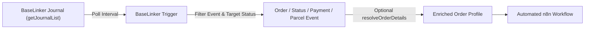

# n8n-nodes-baselinker-api

> ⚡ **High-performance community node** integrating the official [BaseLinker API](https://api.baselinker.com/) with **n8n**.

[](LICENSE)
[-success.svg)](docs/coverage-matrix.md)
[](test/)
[](https://n8n.io/)

**Author:** Ernest Król  
**Project Type:** Independent open-source community node  
**License:** MIT  
**Official BaseLinker Documentation:** [https://api.baselinker.com/](https://api.baselinker.com/)

---

## ⚠️ Disclaimer & Trademark Notice

> [!IMPORTANT]
> - **Limitation of Liability & Data Responsibility:** The author assumes **no responsibility or liability** for the operation, correctness, security, or data handling of this community node. Any access to, storage of, processing of, or modification of company data, client profiles, orders, customer records, financial transactions, or personal data rests **solely with the end user**. You are strongly advised to thoroughly test workflows in non-production environments before deploying them.
> - **Trademark Ownership:** **“Base”** and **“BaseLinker”**, as well as their respective logos, wordmarks, and trade dress, are registered trademarks owned by **BaseLinker Sp. z o.o.** (and/or its affiliates such as Base.com).
> - **No Affiliation:** The author and this repository are in no way affiliated with, sponsored by, authorized by, or officially endorsed by BaseLinker Sp. z o.o. or Base.com. This is an independent community project.

---

## Table of Contents
- [Overview](#overview)
- [Essential Optimizations for n8n Workflows](#essential-optimizations-for-n8n-workflows)
- [BaseLinker Trigger Node](#baselinker-trigger-node)
- [API Methods Coverage](#api-methods-coverage)
- [Quick Installation](#quick-installation)
- [Credentials Setup](#credentials-setup)
- [Extended Documentation](#extended-documentation)

---

## Overview

The **BaseLinker** node for n8n provides seamless, enterprise-grade connectivity between your e-commerce workflows and the BaseLinker platform. Built for performance and reliability, it achieves **100% complete coverage of the official BaseLinker API with 205 implemented operations across all 7 official API groups** (Orders, Order Returns, Courier Shipments, CRM, Product Catalog, Base Connect, and External Storages).

---

## Essential Optimizations for n8n Workflows

This node is specifically engineered to overcome common integration hurdles, drastically simplifying workflow creation and ensuring production stability:

### 1. Dedicated Polling Trigger Node (`BaseLinkerTrigger`)
- **Zero BaseLinker Dashboard Setup:** BaseLinker lacks an API to configure webhooks dynamically. The `BaseLinkerTrigger` eliminates the need to manually build *Automatic Actions* in the BaseLinker UI for each event.
- **Rolling 3-Day Buffer:** Powered by BaseLinker's 3-day event journal (`getJournalList`), ensuring that workflow downtime, n8n upgrades, or container restarts never cause missed events.
- **Monotonic Event Cursor:** Remembers the last processed event ID (`lastLogId`) automatically in workflow static data.
- **Target Status Filtering:** Filter order status transitions (`log_type: 18`) directly in the trigger to prevent unnecessary workflow executions.
- **Automatic Order Hydration:** Toggle `resolveOrderDetails: true` to instantly receive the enriched order profile (customer details, products, delivery address) in the trigger output without needing downstream lookup nodes.
- **Safe Canvas Testing:** Clicking "Test step" in the n8n canvas safely pulls recent test items without advancing your production cursor.

### 2. Dual Parameter Input Modes (UI Fields vs. Raw JSON)
Every operation supports two interchangeable input modes:
- **Form Fields (UI):** Intuitive, typed form controls with dropdown pickers, validation, and sub-builders for products, packages, and custom fields.
- **Raw Parameters (JSON):** Direct JSON payload input supporting dynamic expressions (e.g. `={{ $json.payload }}`), ideal for piping data from upstream nodes or custom code.

### 3. Automated Multi-Batch Pagination (`returnAll: true`)
- Transparently overcomes BaseLinker's 100-item page limit.
- **Intelligent Cursor Advancing:** Seamlessly paginates using `id_from`, `date_from`, or `date_confirmed_from`.
- **Infinite Loop Guards:** Automatically detects unconfirmed orders (`date_confirmed = 0`) and falls back to `id_from` to prevent duplicate pagination loops.
- **Page-based Pagination:** Automatically advances through catalog products (up to 1,000 items/batch) and CRM clients.

### 4. Built-in Rate-Limit Protection (`delayMs`)
- BaseLinker enforces a strict quota of **100 requests per minute**.
- Multi-batch pagination automatically applies a safe pacing delay (default **`650 ms`**, guaranteeing ≤ 92 req/min) so workflows never crash due to `429 Too Many Requests`.

### 5. Native Binary Data Handling
- **Labels & Documents:** Automatically decodes Base64 shipping labels (`getLabel`), courier documents (`getCourierDocument`), and invoices (`getInvoiceFile`) into native n8n binary attachments ready for Google Drive, email, or S3.
- **Document Uploads:** Upload external PDF invoices or receipts using either raw Base64 strings or directly from upstream incoming n8n binary properties.

### 6. Dynamic Canvas Dropdowns (`methods.loadOptions`)
- Live auto-completion and interactive dropdowns for:
  - Order statuses and status groups
  - Return statuses, reasons, and item statuses
  - Inventories, warehouses, categories, manufacturers, tags, and price groups
  - Couriers, courier accounts, and shipping templates
  - External storages (shops/wholesalers) and storage categories
  - Base Connect integrations
  - PickPack carts and custom extra fields.

### 7. Smart Normalization & Custom Extra Fields
- **Timestamp Normalization:** Automatically converts Unix seconds, milliseconds, ISO 8601 strings, and date strings into BaseLinker-compatible Unix timestamps.
- **Custom Extra Fields:** Interactive visual builder or raw JSON mapping. Automatically formats empty fields as empty strings `""` per BaseLinker requirements to clear values.
- **BaseLinker Error Detection:** Intercepts logical errors returned inside HTTP 200 responses (`status: "ERROR"`) and maps them to descriptive `NodeApiError` exceptions.

---

## BaseLinker Trigger Node



The trigger node monitors order lifecycle changes using the following pre-configured options:
- **Order Created (`log_type: 1`)**
- **Order Status Changed (`log_type: 18`)** *(with live Target Status dropdown)*
- **Order Paid (`log_type: 3`)**
- **Courier Package Created (`log_type: 9`)**
- **Courier Package Status Changed (`log_type: 22`)**
- **Invoice Issued (`log_type: 7`)**
- **All Order Events (`all`)**
- **Custom Event Types (`custom`)** *(multi-select any combination of all 22 official BaseLinker log types)*.

👉 *Read the full [Trigger Node Guide](docs/trigger-guide.md) for architecture details, cold-start options, and examples.*

---

## API Methods Coverage

The node provides **100% total coverage** across all 7 official BaseLinker API categories:

| API Group | Total Methods | Implemented | Coverage | Status |
|---|:---:|:---:|:---:|:---:|
| **1. Orders** | 51 | 51 | 100% | ✅ Fully Implemented |
| **2. Order returns** | 21 | 21 | 100% | ✅ Fully Implemented |
| **3. Courier shipments** | 16 | 16 | 100% | ✅ Fully Implemented |
| **4. Clients (CRM)** | 11 | 11 | 100% | ✅ Fully Implemented |
| **5. Product catalog** | 94 | 94 | 100% | ✅ Fully Implemented |
| **6. Base Connect** | 5 | 5 | 100% | ✅ Fully Implemented |
| **7. External storages** | 7 | 7 | 100% | ✅ Fully Implemented |
| **Total** | **205** | **205** | **100%** | ✅ 100% Official API Coverage |

👉 *Check the complete method-by-method checklist in the [Full Coverage Matrix](docs/coverage-matrix.md).*

---

## Quick Installation

### Community Node Installation (in n8n UI)
1. In your n8n instance, go to **Settings -> Community Nodes**.
2. Select **Install**.
3. Enter `n8n-nodes-baselinker-api` and confirm the installation.
4. Restart n8n if running locally.

### Self-Hosted Docker Installation (Bind Mount without Custom Image)
Mount the compiled repository folder directly into your container via `docker-compose.yml`:
```yaml
services:
  n8n:
    image: docker.n8n.io/n8nio/n8n:latest
    environment:
      - N8N_COMMUNITY_PACKAGES_ENABLED=true
    volumes:
      - /path/on/host/n8n_data:/home/node/.n8n
      - /path/on/host/n8n-nodes-baselinker-api:/home/node/n8n-nodes-baselinker-api:ro
```
Then run `npm install /home/node/n8n-nodes-baselinker-api` inside the container or host data folder and restart.  
👉 *See the full [Self-Hosted Docker Guide](docs/docker-installation.md) for complete instructions.*

### Local Development Installation
```bash
git clone https://github.com/ernestkrol/n8n-nodes-baselinker-api.git
cd n8n-nodes-baselinker-api
npm install
npm run build
npm test
```

---

## Credentials Setup

1. In your BaseLinker dashboard, navigate to **Account & other -> My account -> API**.
2. Copy or generate your **API token**.
3. In n8n, navigate to **Credentials -> New Credential** and select **BaseLinker API**.
4. Enter your API Token (`X-BLToken`). n8n automatically tests the connection by querying `getOrderStatusList`.

---

## Extended Documentation

For in-depth details, configuration parameters, and recipes, explore the documentation in [`docs/`](docs/):

- 📘 **[API Reference](docs/api-reference.md):** Exhaustive parameter descriptions, UI controls, and response schemas for all 205 implemented operations.
- 📊 **[API Coverage Matrix](docs/coverage-matrix.md):** Method-by-method checklist for all 205 official BaseLinker endpoints.
- ⚡ **[Trigger Node Guide](docs/trigger-guide.md):** Deep-dive into event journal polling, cold-start modes, status filtering, and order hydration.
- 🔄 **[Pagination & Rate Limiting Strategy](docs/pagination-and-rate-limiting.md):** Detailed guide to cursors, rate-limit safety, and batch loop mechanics.
- 💡 **[Workflow Recipes & Examples](docs/workflows.md):** Real-world automation patterns (order syncing, label emailing, CRM sync, return/refund processing).
- 🐳 **[Docker Installation Guide](docs/docker-installation.md):** Bind mount pattern for running community nodes without rebuilding Docker images.
- 🗺️ **[Development Roadmap](docs/roadmap.md):** Phased milestones tracking past completions and upcoming features.
- 🚀 **[Publishing Guide](publishing/README.md):** Complete step-by-step instructions for publishing this node to npmjs via GitHub Actions with cryptographic provenance.

---

## License

This project is licensed under the [MIT License](LICENSE).
