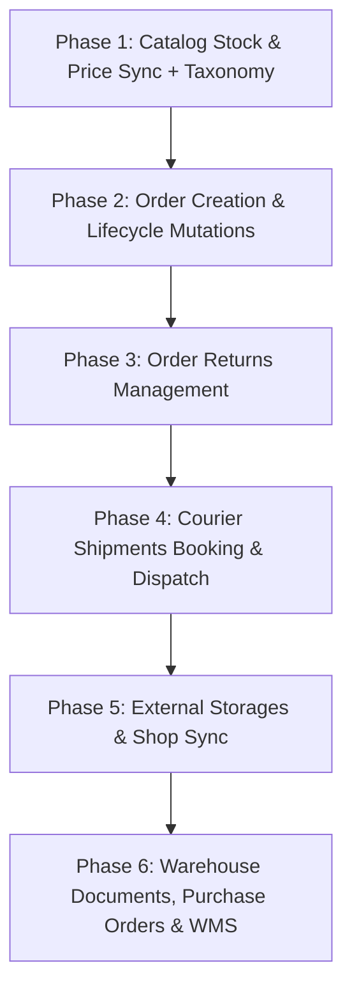

# Development Roadmap & Phased Milestones

The development of **n8n-nodes-baselinker-api** is structured in strategic phases to prioritize high-impact e-commerce workflows (stock and price synchronization, order processing, return workflows, and shipping label dispatch):

---

## ✅ Phase 1: Catalog Stock & Price Sync + Taxonomy (Completed)
- [x] **Stock & Price Updates:**
  - [`updateInventoryProductsStock`](https://api.baselinker.com/index.php?method=updateInventoryProductsStock) — Bulk stock updates (up to 1,000 products per request).
  - [`updateInventoryProductsPrices`](https://api.baselinker.com/index.php?method=updateInventoryProductsPrices) — Bulk gross price updates per price group.
- [x] **Catalog Taxonomy & Dropdowns:**
  - [`getInventoryCategories`](https://api.baselinker.com/index.php?method=getInventoryCategories), [`addInventoryCategory`](https://api.baselinker.com/index.php?method=addInventoryCategory), [`deleteInventoryCategory`](https://api.baselinker.com/index.php?method=deleteInventoryCategory)
  - [`getInventoryTags`](https://api.baselinker.com/index.php?method=getInventoryTags), [`addInventoryTag`](https://api.baselinker.com/index.php?method=addInventoryTag), [`deleteInventoryTag`](https://api.baselinker.com/index.php?method=deleteInventoryTag)
  - [`getInventoryManufacturers`](https://api.baselinker.com/index.php?method=getInventoryManufacturers), [`addInventoryManufacturer`](https://api.baselinker.com/index.php?method=addInventoryManufacturer), [`deleteInventoryManufacturer`](https://api.baselinker.com/index.php?method=deleteInventoryManufacturer)
  - [`getInventoryPriceGroups`](https://api.baselinker.com/index.php?method=getInventoryPriceGroups), [`addInventoryPriceGroup`](https://api.baselinker.com/index.php?method=addInventoryPriceGroup), [`deleteInventoryPriceGroup`](https://api.baselinker.com/index.php?method=deleteInventoryPriceGroup)
  - [`getInventoryExtraFields`](https://api.baselinker.com/index.php?method=getInventoryExtraFields), [`getInventoryAvailableTextFieldKeys`](https://api.baselinker.com/index.php?method=getInventoryAvailableTextFieldKeys)
- [x] **Product Mutations:**
  - [`addInventoryProduct`](https://api.baselinker.com/index.php?method=addInventoryProduct), [`deleteInventoryProduct`](https://api.baselinker.com/index.php?method=deleteInventoryProduct)

---

## ✅ Phase 2: Order Creation & Lifecycle Mutations (Completed)
- [x] **Order Mutations (Completed):**
  - [`addOrder`](https://api.baselinker.com/index.php?method=addOrder), [`addOrderBySplit`](https://api.baselinker.com/index.php?method=addOrderBySplit), [`addOrderDuplicate`](https://api.baselinker.com/index.php?method=addOrderDuplicate), [`deleteOrders`](https://api.baselinker.com/index.php?method=deleteOrders), [`setOrdersMerge`](https://api.baselinker.com/index.php?method=setOrdersMerge)
- [x] **Order Products (Completed):**
  - [`addOrderProduct`](https://api.baselinker.com/index.php?method=addOrderProduct), [`deleteOrderProduct`](https://api.baselinker.com/index.php?method=deleteOrderProduct), [`setOrderProductFields`](https://api.baselinker.com/index.php?method=setOrderProductFields)
- [x] **Status & Payment Workflow (Completed):**
  - [`setOrderPayment`](https://api.baselinker.com/index.php?method=setOrderPayment)
  - [`setOrderStatus`](https://api.baselinker.com/index.php?method=setOrderStatus), [`setOrderStatuses`](https://api.baselinker.com/index.php?method=setOrderStatuses)
  - [`addOrderStatus`](https://api.baselinker.com/index.php?method=addOrderStatus), [`addOrderStatusGroup`](https://api.baselinker.com/index.php?method=addOrderStatusGroup)
  - [`deleteOrderStatus`](https://api.baselinker.com/index.php?method=deleteOrderStatus), [`deleteOrderStatusGroup`](https://api.baselinker.com/index.php?method=deleteOrderStatusGroup)
- [x] **Invoices & Receipts (Completed):**
  - [`addInvoice`](https://api.baselinker.com/index.php?method=addInvoice), [`addInvoiceCorrection`](https://api.baselinker.com/index.php?method=addInvoiceCorrection), [`addOrderInvoiceFile`](https://api.baselinker.com/index.php?method=addOrderInvoiceFile)
  - [`getReceipts`](https://api.baselinker.com/index.php?method=getReceipts), [`getNewReceipts`](https://api.baselinker.com/index.php?method=getNewReceipts), [`addReceipt`](https://api.baselinker.com/index.php?method=addReceipt), [`setOrderReceipt`](https://api.baselinker.com/index.php?method=setOrderReceipt), [`getReceipt`](https://api.baselinker.com/index.php?method=getReceipt), [`addOrderReceiptFile`](https://api.baselinker.com/index.php?method=addOrderReceiptFile)
- [x] **Pick Lists, PickPack Carts & Logistics (Completed):**
  - [`addOrderPickList`](https://api.baselinker.com/index.php?method=addOrderPickList), [`getOrderPickLists`](https://api.baselinker.com/index.php?method=getOrderPickLists)
  - [`getPickPackCarts`](https://api.baselinker.com/index.php?method=getPickPackCarts), [`addPickPackCart`](https://api.baselinker.com/index.php?method=addPickPackCart), [`deletePickPackCart`](https://api.baselinker.com/index.php?method=deletePickPackCart), [`getPickPackCartOrders`](https://api.baselinker.com/index.php?method=getPickPackCartOrders), [`getPickPackOrderCart`](https://api.baselinker.com/index.php?method=getPickPackOrderCart), [`addPickPackOrdersToCart`](https://api.baselinker.com/index.php?method=addPickPackOrdersToCart), [`deletePickPackCartOrders`](https://api.baselinker.com/index.php?method=deletePickPackCartOrders), [`deletePickPackOrderFromCart`](https://api.baselinker.com/index.php?method=deletePickPackOrderFromCart), [`getOrderPickPackHistory`](https://api.baselinker.com/index.php?method=getOrderPickPackHistory)
- [x] **Lookups & Macros (Completed):**
  - [`getOrdersByEmail`](https://api.baselinker.com/index.php?method=getOrdersByEmail), [`getOrdersByPhone`](https://api.baselinker.com/index.php?method=getOrdersByPhone), [`getOrderTransactionData`](https://api.baselinker.com/index.php?method=getOrderTransactionData), [`getOrderPrintoutTemplates`](https://api.baselinker.com/index.php?method=getOrderPrintoutTemplates), [`runOrderMacroTrigger`](https://api.baselinker.com/index.php?method=runOrderMacroTrigger)

---

## ✅ Phase 3: Order Returns (Completed)
- [x] **Return Management (Completed):**
  - [`getOrderReturns`](https://api.baselinker.com/index.php?method=getOrderReturns), [`addOrderReturn`](https://api.baselinker.com/index.php?method=addOrderReturn), [`setOrderReturnFields`](https://api.baselinker.com/index.php?method=setOrderReturnFields)
  - [`getOrderReturnExtraFields`](https://api.baselinker.com/index.php?method=getOrderReturnExtraFields), [`getOrderReturnJournalList`](https://api.baselinker.com/index.php?method=getOrderReturnJournalList)
- [x] **Return Products & Statuses (Completed):**
  - [`addOrderReturnProduct`](https://api.baselinker.com/index.php?method=addOrderReturnProduct), [`deleteOrderReturnProduct`](https://api.baselinker.com/index.php?method=deleteOrderReturnProduct), [`setOrderReturnProductFields`](https://api.baselinker.com/index.php?method=setOrderReturnProductFields)
  - [`getOrderReturnStatusList`](https://api.baselinker.com/index.php?method=getOrderReturnStatusList), [`getOrderReturnStatusGroups`](https://api.baselinker.com/index.php?method=getOrderReturnStatusGroups), [`setOrderReturnStatus`](https://api.baselinker.com/index.php?method=setOrderReturnStatus), [`setOrderReturnStatuses`](https://api.baselinker.com/index.php?method=setOrderReturnStatuses)
  - [`addOrderReturnStatus`](https://api.baselinker.com/index.php?method=addOrderReturnStatus), [`addOrderReturnStatusGroup`](https://api.baselinker.com/index.php?method=addOrderReturnStatusGroup)
  - [`deleteOrderReturnStatus`](https://api.baselinker.com/index.php?method=deleteOrderReturnStatus), [`deleteOrderReturnStatusGroup`](https://api.baselinker.com/index.php?method=deleteOrderReturnStatusGroup)
  - [`getOrderReturnReasonsList`](https://api.baselinker.com/index.php?method=getOrderReturnReasonsList), [`getOrderReturnProductStatuses`](https://api.baselinker.com/index.php?method=getOrderReturnProductStatuses)
- [x] **Refunds & Triggers (Completed):**
  - [`getOrderReturnPaymentsHistory`](https://api.baselinker.com/index.php?method=getOrderReturnPaymentsHistory), [`setOrderReturnRefund`](https://api.baselinker.com/index.php?method=setOrderReturnRefund), [`runOrderReturnMacroTrigger`](https://api.baselinker.com/index.php?method=runOrderReturnMacroTrigger)

---

## ✅ Phase 4: Courier Shipments Booking & Dispatch (Completed)
- [x] **Package Booking:**
  - [`createPackage`](https://api.baselinker.com/index.php?method=createPackage), [`createPackageManual`](https://api.baselinker.com/index.php?method=createPackageManual), [`deleteCourierPackage`](https://api.baselinker.com/index.php?method=deleteCourierPackage), [`getPricePackage`](https://api.baselinker.com/index.php?method=getPricePackage)
- [x] **Courier Info & Metadata:**
  - [`getCouriersList`](https://api.baselinker.com/index.php?method=getCouriersList), [`getCourierAccounts`](https://api.baselinker.com/index.php?method=getCourierAccounts), [`getCourierFields`](https://api.baselinker.com/index.php?method=getCourierFields), [`getCourierServices`](https://api.baselinker.com/index.php?method=getCourierServices)
- [x] **Pickups & Dispatch:**
  - [`runRequestParcelPickup`](https://api.baselinker.com/index.php?method=runRequestParcelPickup), [`getRequestParcelPickupFields`](https://api.baselinker.com/index.php?method=getRequestParcelPickupFields)
  - [`getProtocol`](https://api.baselinker.com/index.php?method=getProtocol), [`getCourierDocument`](https://api.baselinker.com/index.php?method=getCourierDocument)

---

## ✅ Phase 5: External Storages (Completed)
- [x] **External Storages & Shop Sync (Completed):**
  - [`getExternalStoragesList`](https://api.baselinker.com/index.php?method=getExternalStoragesList), [`getExternalStorageCategories`](https://api.baselinker.com/index.php?method=getExternalStorageCategories)
  - [`getExternalStorageProductsList`](https://api.baselinker.com/index.php?method=getExternalStorageProductsList), [`getExternalStorageProductsData`](https://api.baselinker.com/index.php?method=getExternalStorageProductsData)
  - [`getExternalStorageProductsQuantity`](https://api.baselinker.com/index.php?method=getExternalStorageProductsQuantity), [`updateExternalStorageProductsQuantity`](https://api.baselinker.com/index.php?method=updateExternalStorageProductsQuantity)
  - [`getExternalStorageProductsPrices`](https://api.baselinker.com/index.php?method=getExternalStorageProductsPrices)

---

## ✅ Phase 6: Warehouse Documents, Purchase Orders, WMS & Base Connect (Completed)
- [x] **Inventory Documents (Completed):**
  - [`getInventoryDocuments`](https://api.baselinker.com/index.php?method=getInventoryDocuments), [`addInventoryDocument`](https://api.baselinker.com/index.php?method=addInventoryDocument), [`addInventoryDocumentFile`](https://api.baselinker.com/index.php?method=addInventoryDocumentFile), [`addInventoryDocumentItems`](https://api.baselinker.com/index.php?method=addInventoryDocumentItems), [`getInventoryDocumentFile`](https://api.baselinker.com/index.php?method=getInventoryDocumentFile), [`getInventoryDocumentItems`](https://api.baselinker.com/index.php?method=getInventoryDocumentItems), [`setInventoryDocumentStatusConfirmed`](https://api.baselinker.com/index.php?method=setInventoryDocumentStatusConfirmed)
- [x] **Purchase Orders (Completed):**
  - [`getInventoryPurchaseOrders`](https://api.baselinker.com/index.php?method=getInventoryPurchaseOrders), [`addInventoryPurchaseOrder`](https://api.baselinker.com/index.php?method=addInventoryPurchaseOrder), [`addInventoryPurchaseOrderItems`](https://api.baselinker.com/index.php?method=addInventoryPurchaseOrderItems), [`setInventoryPurchaseOrderStatus`](https://api.baselinker.com/index.php?method=setInventoryPurchaseOrderStatus), [`getInventoryPurchaseOrderLogs`](https://api.baselinker.com/index.php?method=getInventoryPurchaseOrderLogs)
- [x] **Warehouse Logistics (Completed):**
  - Transfers: [`getInventoryTransfers`](https://api.baselinker.com/index.php?method=getInventoryTransfers), [`addInventoryTransfer`](https://api.baselinker.com/index.php?method=addInventoryTransfer), [`setInventoryTransferStatus`](https://api.baselinker.com/index.php?method=setInventoryTransferStatus)
  - Stocktakes: [`getInventoryStocktakes`](https://api.baselinker.com/index.php?method=getInventoryStocktakes), [`addInventoryStocktake`](https://api.baselinker.com/index.php?method=addInventoryStocktake), [`setInventoryStocktakeStatus`](https://api.baselinker.com/index.php?method=setInventoryStocktakeStatus)
  - Fulfillment deliveries: [`getInventoryFulfillmentDeliveries`](https://api.baselinker.com/index.php?method=getInventoryFulfillmentDeliveries), [`addInventoryFulfillmentDelivery`](https://api.baselinker.com/index.php?method=addInventoryFulfillmentDelivery)
- [x] **Base Connect (Completed):**
  - [`getConnectIntegrations`](https://api.baselinker.com/index.php?method=getConnectIntegrations), [`getConnectIntegrationContractors`](https://api.baselinker.com/index.php?method=getConnectIntegrationContractors), [`getConnectContractorCreditHistory`](https://api.baselinker.com/index.php?method=getConnectContractorCreditHistory), [`addConnectContractorCreditSettlement`](https://api.baselinker.com/index.php?method=addConnectContractorCreditSettlement), [`setConnectContractorCreditLimit`](https://api.baselinker.com/index.php?method=setConnectContractorCreditLimit)
